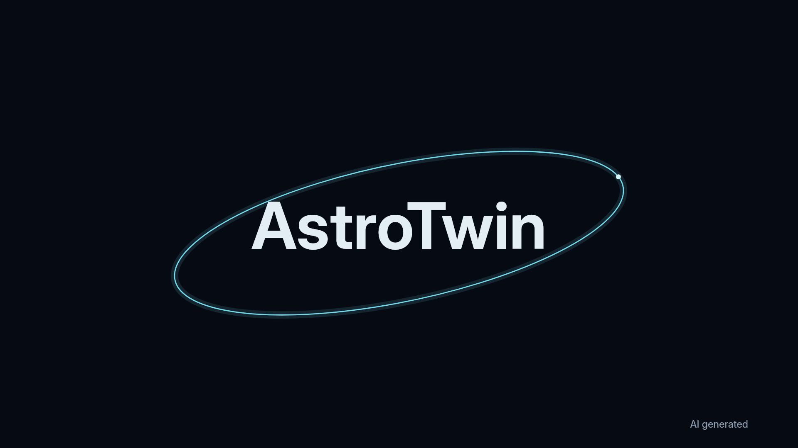

# AstroTwin

A browser-based astronaut health research prototype with an orbital workspace, visual crew and flight planning, interactive anatomy, measured research data, and a routine optimizer that evaluates the existing forecast model.

[Open AstroTwin](https://astrotwin-eight.vercel.app) · Public website and forecast API hosted on Vercel

## Project video

[Watch or download the final AstroTwin video](docs/media/astrotwin-demo.mp4) · 30 seconds · 1920×1080 · 60 fps

[](docs/media/astrotwin-demo.mp4)

The video demonstrates flight planning, the 2D and 3D body views, NASA Sprint Study measurements, model forecasts and routine comparison. Music: Tycho — Awake. The AI watermark is included in the video.

## Open the web app

From CMD in the repository folder:

```cmd
cd /d "C:\Users\adity\OneDrive\Documents\SpaceApps\SpaceApps2026"
npm start
```

Open **http://localhost:8000**. This command builds the UI and starts one Python service for both the page and /api. Press Ctrl+C to stop it. Close any previous server using port 8000 first; to use another port in CMD, run `set PORT=8001` before `npm start`.

No Electron window or new dependency installation is needed for an existing working checkout.

## First-time setup

Requires Python 3.11 and Node 20.19+ or a supported newer LTS. From the repository root:

```cmd
py -3.11 -m venv .venv
.venv\Scripts\python.exe -m pip install -e model -e explain -r api/requirements.lock
npm --prefix web ci
npm start
```

Reuse an existing working .venv. ASTROTWIN_PYTHON can point to another Python executable. Root npm installation is unnecessary for the web runtime; root desktop dependencies are retained only for optional legacy builds.

## Workspace and navigation

AstroTwin opens on a flight-management workspace. Choose **New flight**, give it a name and assign an astronaut. Its setup, body view and routine comparison stay together as one saved record.

- **Workspace** (`#/`): create, search, open, rename, archive and restore flights.
- **Astronauts** (`#/astronauts`): browse the four fictional starter profiles, add a simulation profile, edit its name/role and open or create its linked flights.
- **Flight setup** (`#/mission`): edit the current flight's destination, duration, astronaut, routine and optional injury scenario.
- **Body view** (`#/explore`): the human reference model and mission-to-recovery timeline for the current flight.
- **Compare routines** (`#/compare`): a separately saved alternative routine for that flight, with optional detailed charts.
- **Research & sources** (`#/research`): original measurements, citations, model assumptions and asset attribution.

Flights, profiles and the selected flight save in this browser's local storage, including across a refresh. Use the same browser and origin/port to reopen them. This is local browser persistence, not cloud accounts or shared-client storage. If saved data cannot be read, it is preserved instead of silently overwritten; the app reports when changes can only last for the session.

New profiles copy a fictional research template; entering a name does not create a medically validated personal twin. Profile name/role edits update linked flight labels while preserving research settings. Archiving keeps a flight's inputs and comparison available for restoration.

The navigation rail separates the workspace from the current flight. Icon labels appear on hover and keyboard focus, with persistent labels on small screens. Back/Forward and reduced-motion page transitions remain available. Crew portraits, planet artwork, human assets and research summaries are bundled locally. The MakeHuman surface is a generic CC0 illustration, not a NASA scan. Methodology and presentation notes are in [docs/science.md](docs/science.md) and [docs/INTERFACE.md](docs/INTERFACE.md).

## Development

For hot reload, run these separately:

```cmd
.venv\Scripts\python.exe -m uvicorn api.main:app --reload --port 8000
npm run dev:web
```

Open http://localhost:5173. The body sandbox remains `?sandbox=body`.

`npm run build:web` builds for the same-origin server. For a separately hosted API, build web/ directly with VITE_API_URL set to the complete API base ending in /api, and configure WEB_ORIGIN on the API.

## Vercel deployment

`vercel.json` deploys the Vite frontend and FastAPI backend as two services under one domain. Requests to `/api/*` reach the Python service; the remaining routes serve the built frontend. The root `asgi.py` entry point uses Python 3.12 and the dependencies in `pyproject.toml` and `uv.lock`, including the local `model/` and `explain/` packages.

From a checkout linked to the `astrotwin` Vercel project:

```sh
npx vercel@65.16.0 deploy --prod --build-env VITE_API_URL=/api --build-env VITE_USE_MOCKS=false
```

The production site is public and needs no login. No API keys or database are required. `.vercel/` and environment files remain outside Git. The commercial authoring files and video exports are excluded from deployment uploads.

## Checks and model notes

[CONTRACT.md](CONTRACT.md) records unchanged data interfaces and the browser startup. [VALIDATION.md](VALIDATION.md) records actual checks and limits. [docs/science.md](docs/science.md) classifies model assumptions; `.venv\Scripts\python.exe docs/validate.py` regenerates the consistency report.

The earlier full test/check scripts remain available. UI work is checked with a production build and focused browser interaction instead of repeatedly running every suite.

## Optional container delivery

```cmd
docker build -f api/Dockerfile -t astrotwin .
docker run --rm -p 8000:8000 astrotwin
```

The multi-stage recipe builds the renderer and serves UI/API together. Its Docker build could not be run locally because the Docker engine is unavailable. The public website uses Vercel Services instead. See docs/RELEASE.md for the container recipe.

## Earlier desktop work

The desktop/ folder, optional `npm run start:desktop` and installer recipes are preserved. They are no longer part of normal browser startup. The shared integration branch remains default.

## Reproduce the research fit

```cmd
.venv\Scripts\python.exe scripts/calibrate.py
.venv\Scripts\python.exe docs/validate.py
```

The study transcription is in data/research/sprint_control.json. The generated report distinguishes fitting its source endpoints from a separate historical challenge that the daily curve does not reproduce. See docs/science.md for the full method and limitations. Four source endpoints fitting to rounding does not imply prediction accuracy.
